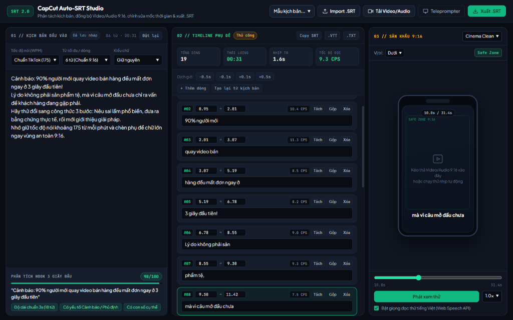

# CapCut Auto-SRT Studio v2.0

**Công cụ biên tập phụ đề tiếng Việt chạy 100% trên trình duyệt: tự động ngắt nhịp chuẩn TikTok/Reels, Import & chỉnh mốc `.SRT / .VTT`, nạp Video/Audio thật vào khung 9:16 và xuất file kéo thẳng vào CapCut.**

*Phát triển bởi [Quốc Tuấn (@quoctuan364)](https://github.com/quoctuan364)*

---

## Live Demo Trực Tuyến

Mở và sử dụng ngay trên trình duyệt (không cần cài đặt, không upload dữ liệu ra ngoài):
- **https://quoctuan364.github.io/capcut-srt-studio/**

---

## Tính Năng Mới ở Phiên Bản v2.0

1. **Nạp Video / Audio Thật vào Khung 9:16 (Drag & Drop Media):**
   - Kéo thả trực tiếp video quay dọc hoặc file thu âm vào màn hình mô phỏng để căn chữ ngay trên video thật.
   - Hỗ trợ thanh tua (Scrub Bar), tốc độ phát `0.75x / 1.0x / 1.25x`, phím tắt `Space`, Safe Zone 9:16 và chọn vị trí phụ đề (Dưới / Giữa / Trên).
2. **Import & Biên Tập Timeline `.SRT / .VTT` Chuyên Sâu:**
   - Nhập file `.SRT` hoặc `.VTT` có sẵn để sửa lỗi chính tả và đồng bộ lại thời gian.
   - **Time-Shift toàn bộ timeline** (`-0.5s`, `-0.1s`, `+0.1s`, `+0.5s`), chỉnh trực tiếp giây bắt đầu/kết thúc từng dòng, **Tách đôi (`Split`)**, **Gộp dòng (`Merge`)**, và **cảnh báo tốc độ đọc (CPS > 20)** giúp phụ đề không bị trôi quá nhanh.
3. **Thuật Toán Ngắt Nhịp Tiếng Việt & Viral Hook Analyzer:**
   - Tự chia dòng theo nhịp ngắt câu (4 / 6 / 9 từ, chống lẻ 1 từ cuối dòng) theo tốc độ nói `130–230 WPM`.
   - Chấm điểm câu mở đầu 3 giây kèm thanh tiến độ và gợi ý sửa Hook.
4. **Tự Động Lưu Nháp (`localStorage`) & Teleprompter Toàn Màn Hình:**
   - Không lo mất kịch bản khi tải lại trang; hỗ trợ 3 mẫu kịch bản nhanh (`Tech`, `Review`, `Story`) và máy nhắc chữ lật gương.

---

## Cách Chạy Cục Bộ Trên Windows

Nháy đúp file `start-capcut.bat` (hoặc mở trực tiếp `index.html` trên trình duyệt).

## Giấy phép

MIT License — [@quoctuan364](https://github.com/quoctuan364).
